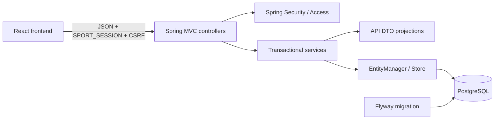
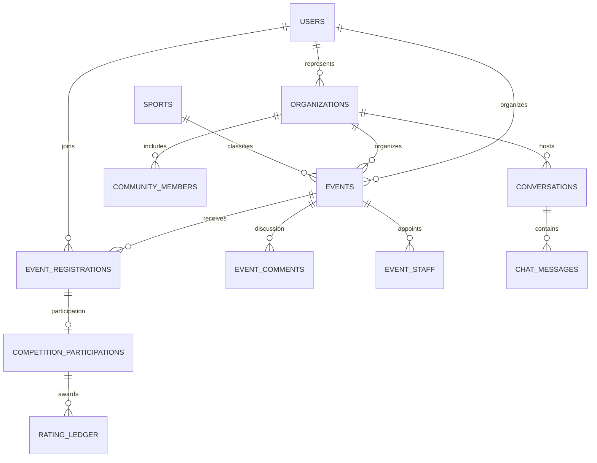

# Архитектура backend

Модули сервисов: Session, Profile, Event, Organization, Registration, Discussion, Rating, Messaging. Каждый модуль проверяет права на конкретный объект. Controller и DTO в `api`; JPA-сущности — в `domain`. `Views` собирает публичные DTO и серверные значения рейтинга/числа участников. `PatchValidator` читает свойства исходного OpenAPI для различения отсутствующего поля и явного null, проверки enum, размеров и запрета дополнительных полей.

У DIRECT в conversations хранятся два пользователя и уникальный канонический ключ пары. У COMMUNITY — ссылка на организацию, участники вычисляются из community_members. Это не дублирует членство при создании нескольких групп одного клуба. В таблице moderation_actions сохраняется кто, когда, что и с какой причиной решил. Отдельные user_sport_roles и user_sport_preferences хранят роли и предпочтения, organization_sports — интересы организации.

Ограничения БД: FK, уникальность ников без учёта регистра, регистрации пользователя на событие и пары DIRECT, уникальный источник проводки, XOR владельца события, предел мест и координат, допустимые состояния. Индексы покрывают каталог по статусу/дате/спорту, регистрации по событию/статусу и пользователю, обсуждения и историю переписки.

Транзакции мутаций имеют event/organization/user row locks для соответствующих бизнес-инвариантов. Поведение при гонках проверяют PostgreSQL-тесты, их запуск обязателен перед утверждением гарантии в рабочем окружении.

Границы масштабирования прототипа: один экземпляр с локальными сессиями; проекции используют дополнительные запросы к БД, а рекомендации ранжируют кандидатов в памяти. Для большого каталога нужны пакетные проекции и SQL scoring, для нескольких экземпляров — общее хранилище сессий. Эти ограничения не требуют изменения модели событий и прав.
