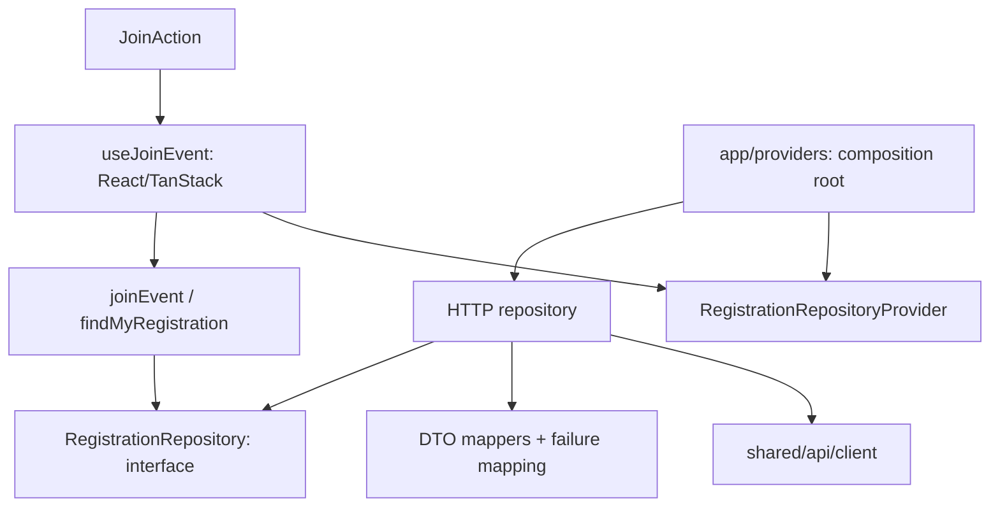

# Архитектура frontend

Статус: постепенный переход к Clean Architecture с принципами Feature-Sliced Design. Сценарии S3 OPEN и S4 APPROVAL уже разделены на чистое ядро, адаптеры и React. Остальные экраны приведены к слоям FSD, но создание события и сессия пока используют прежний query/service-подход. Весь проект ещё не считается полностью переведённым на Clean Architecture.

## Структура и направление зависимостей

```text
src/
  app/                          router, layout, composition root/providers
  pages/                        сборка каталога, события, создания, входа и кабинетов
  features/
    join-event/model/           независимые сценарии joinEvent/findMyRegistration
    join-event/ui/              JoinAction, useJoinEvent, TanStack query options
    review-registrations/model/  проверка ответа решения организатора
    review-registrations/ui/     список, фильтры, пагинация, форма отказа и mutation
    create-event/ui/            существующая форма и её Zod-схема
  entities/
    event/                      API/query, карточка, форматирование, EventParticipation
    registration/model/         Registration, ParticipantPage, repository port, failures
    registration/api/           HTTP-репозиторий, DTO mappers, read query options
    registration/lib/           React context для внедрения репозитория
    registration/ui/            участники и отображение статусов/ошибок
    session/                    существующие session/demo query/services
  shared/                       транспорт, generated DTO, общие UI и токены
  mocks/                        MSW и локальная эмуляция backend
  tests/                        проверки ядра, адаптеров, UI и границ
```

Допустимое направление слоёв: `app → pages → features → entities → shared`. Промежуточные слои можно пропускать. Модуль одного слоя не импортирует другой модуль того же слоя; несколько модулей собираются выше. `widgets/` пока не требуется и не создаётся.

Обычные потребители используют публичные `index.ts` модулей. У моделей есть отдельный чистый entry point `entities/*/model/index.ts`, чтобы сценарий не импортировал React через общий barrel. Composition root явно импортирует конкретный HTTP-адаптер. Сам HTTP-адаптер не экспортируется через UI entry point регистрации.

## S3: Clean Architecture



Это направления зависимостей исходного кода. При выполнении сценарий вызывает внедрённую реализацию порта.

- `entities/registration/model` не импортирует React, TanStack Query, Zod, DTO или HTTP. Модель регистрации использует `participant.displayName`/`registeredAt`, а DTO — `user.displayName`/`createdAt`. Это разные представления, преобразование выполняет API-адаптер.
- Порт располагается в модели регистрации, поскольку нужен и сценарию записи, и чтению участников. Он не зависит от конкретной реализации. `AbortSignal` используется как стандартный тип отмены чтения; React/HTTP-код в ядро не передаётся.
- `features/join-event/model` получает репозиторий аргументом. Сценарий проверяет соответствие ответа запрошенному событию и аккаунту. Права, лимит и статус CONFIRMED назначает сервер, сценарий их не вычисляет.
- `createHttpRegistrationRepository(http)` реализует порт: вызывает прежние API-пути, проверяет generated DTO, преобразует их в модели и переводит `ApiError` в `RegistrationFailure`. Только 404 собственной регистрации означает `null`; ошибка чтения участников остаётся ошибкой. Abort сохраняется отменой.
- `useJoinEvent` связывает сценарий с React/TanStack: query, mutation, pending, cache invalidation и защита от позднего ответа предыдущей сессии. В переменных мутации фиксируются eventId/viewerId на момент нажатия. Query cache не входит в ядро.
- `JoinAction` отображает состояние и вызывает hook. HTTP DTO и конкретный HTTP-репозиторий он не импортирует.
- `app/providers.tsx` выбирает реализацию и внедряет её через React context. У context нет скрытого HTTP fallback; отсутствие provider — ошибка конфигурации. DI-контейнер и классы для каждого сценария не нужны.

MSW по-прежнему перехватывает настоящие fetch-запросы на сетевой границе. Отдельный production MockRepository не вводился. Для unit-тестов сценария и React-hook можно передать маленький in-memory test double без HTTP/MSW.

## Сборка страниц

`pages/event` объединяет API события, `JoinAction` и `Participants`. DTO события преобразуется в `EventParticipation` на API-границе сущности. `pages/catalog` связывает карточку события и оформление статуса регистрации через props: сущности event и registration не импортируют друг друга. Форма создания вынесена в `features/create-event`, а её страница отвечает за загрузку исходных данных и состояние входа.

URL, сетевые пути, CSRF/cookie transport, mock persistence и визуальные классы сохранены. Политики доступа/численности не перенесены из backend в клиент.

## Проверка границ

`npm run lint` включает локальное правило `eslint-rules/architecture.js`:

- запрещены зависимости вверх по слоям и импорты соседних slices;
- в `entities/*/model` и `features/*/model` разрешены только чистые model-модули; запрещены внешние framework imports, HTTP/DTO/UI и прямые browser storage/fetch globals;
- фича join-event не подключает HTTP напрямую;
- production-модули не импортируют mocks/tests; bootstrap `main.tsx` подключает MSW явно по режиму.

Правило проверяет относительные static imports, re-exports и dynamic imports; aliases в проекте не настроены. Негативные тесты запускают настоящий ESLint Linter. Проверка не является анализатором всей транзитивной семантики JS: корректность публичных API и глобальных побочных эффектов также требует code review.

## Границы перехода

Контракт находится в `backend/contracts/openapi.yaml` (версия `1.0.0-draft`). `npm run api:generate` создаёт `shared/api/generated/schema.d.ts`, `shared/api/types.ts` экспортирует aliases на generated DTO. `npm run api:check` обнаруживает устаревшую генерацию. Файлы provisional удалены. Runtime guards S3 находятся в `entities/registration/api/mappers.ts`, UI-валидация создания — в `shared/api/event-schema.ts`. Доменная модель регистрации не импортирует generated DTO.

Создание события, каталог и сессия ещё не имеют самостоятельных портов/use cases. Их транспорт и React orchestration остаются в существующих adapters/UI. Следующие переносы выполняются отдельными проверяемыми срезами, без переименования всего кода ради одинаковой структуры. Сессия, каталог, создание и OPEN-запись подключены к Java; браузерные проверки выполняются отдельной конфигурацией `playwright.api.config.ts` с заблокированными service workers.

## Тема и интерфейс

`JoinAction` находится в `features/join-event/ui`, карта отображения статуса — в `entities/registration/ui/presentation.ts`. Цвета, размеры и радиусы централизованы в `src/shared/styles/index.css`; CSS custom properties — источник темы, Tailwind 4 подключён через `@import 'tailwindcss'`. Визуальные правила описаны в [DESIGN_SYSTEM.md](DESIGN_SYSTEM.md).

## Подключение Java

В mock и real используется один HTTP-адаптер. `npm run dev`/`dev:real` выбирает Java, `dev:mock` явно включает MSW; автоматического fallback нет. Точные wire-типы берутся из OpenAPI, а модель регистрации и use cases сохраняют независимость от транспорта.

Каталог использует `EventCard`, детальная страница — `Event`. Query детальной страницы дополнительно читает `/events/{id}/team`: доступность действия приходит из `TeamStatus.joinAvailable/waitlistAvailable`, а права организатора — из `Event.viewerIsOrganizer`. Это уже реализованный серверный P1 endpoint, используемый как зависимость P0-записи. Новый API или клиентское назначение прав не вводились.

Создание отправляет `sport: {sportId}|{customName}`, `maxParticipants`, `organizer: {type:USER,id}` и `publishNow`; Java проверяет, что указанный автор совпадает с сессией. UI не предлагает запись самому организатору; это интерфейсное решение, а не утверждение о серверном запрете. Участники приходят как `PublicUser[]`, ошибки полей — `ApiError.details[]`.

Модель регистрации поддерживает все пять статусов контракта для чтения уже существующих данных. APPROVAL-подача и решения подключены. Отмена и очередь пока не подключены в UI. Их наличие в enum не означает готовый пользовательский сценарий.

## S4: рассмотрение заявок

`pages/event` собирает `JoinAction`, `RegistrationRequests` и `Participants`. Фичи join-event и review-registrations не импортируют друг друга. Они используют общий RegistrationRepository из сущности регистрации. Runtime schema адаптера преобразует Registration DTO и PagedRegistrations в самостоятельные Registration/RegistrationPage, включая message и decisionReason. В wire-адаптере outcome accept/decline преобразуется в контрактный APPROVE/REJECT.

`reviewRegistration` не назначает права или места: он вызывает сервер и отклоняет ответ с чужими eventId/registrationId/participantId либо неправильным итоговым статусом. `useReviewRegistration` фиксирует viewerId и проверяет текущую сессию до объявления успеха и invalidation. Список приватных заявок имеет viewerId в query key.

`RequestRow` отвечает за отображение заявки и доступную с клавиатуры RHF/Zod-форму отказа; `RegistrationRequests` — за query, фильтр, пагинацию и сообщение о сохранении. Метки статусов для организатора и участника находятся в одной карте сущности. PENDING не входит в PublicUser-список участников. HTTP polling обновляет статус у заявителя без перезагрузки и обновляет публичные участники/численность после решения. Отдельная реализация для MSW не внедряется в production-код.
